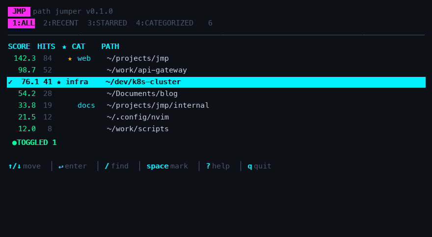

# jmp

[English](README.md) | [简体中文](README.zh-CN.md)

**jmp** is a smart directory jumper — a Go rewrite and enhancement of
[autojump](https://github.com/wting/autojump). It learns the directories you
`cd` into and lets you jump back to them with a few keystrokes.

Ranking uses a **frecency** algorithm (frequency + time decay), with substring
matching preferred over fuzzy matching. It is cross-platform:
macOS / Linux / WSL / Windows.

---

## Features

- 🚀 **One-key jump** — `j foo` jumps to the most-used directory matching `foo`.
- 🧠 **Frecency ranking** — combines visit frequency with a 7-day half-life
  recency decay, so recently and frequently used dirs win.
- 🔍 **Substring + fuzzy matching** — exact substring hits always rank above
  fuzzy matches; multi-keyword queries narrow results.
- 🏷️ **Aliases** — `jmp alias set proj /code/project`, then `j @proj`.
- 🖥️ **TUI manager** — interactive viewer (Bubble Tea) to search, star,
  categorize, edit weights, and delete entries.
- 🐚 **Shell integration** — bash, zsh, fish, and PowerShell, with tab
  completion and `back` / `fwd` / `-` navigation history.
- 🔄 **Multi-device sync** — sync the database across machines over SSH/SCP
  (pull → merge → push), with a configurable interval.
- 📥 **Import** — ingest paths from a text file or common history files.
- 🧰 **Maintenance** — `doctor`, `clean`, `stats`, JSON output, and more.

<p align="center">
  
</p>

## Quick Start

On a new machine:

```bash
# 1. Install Homebrew first (macOS / Linux) — https://brew.sh
/bin/bash -c "$(curl -fsSL https://raw.githubusercontent.com/Homebrew/install/HEAD/install.sh)"

# 2. Install jmp
brew install biyan113/tap/jmp
# Homebrew 6.0+: if prompted to trust the tap, run `brew trust biyan113/tap`

# 3. Add this line to your shell config (~/.zshrc), then restart the shell
eval "$(jmp init zsh)"        # bash: same; fish: `jmp init fish | source`
```

Now `cd` around to build history, then `j foo` jumps to the best match.
See [Shell Integration](#shell-integration) and [Usage](#usage) for more.

## Installation

```bash
# Option 1: Homebrew (macOS / Linux)
brew install biyan113/tap/jmp

# Option 2: go install (needs Go 1.21+)
go install github.com/biyan113/jmp@latest

# Option 3: build from source
make build
make install   # installs to /usr/local/bin/jmp

# Option 4: download a prebuilt binary from Releases
# https://github.com/biyan113/jmp/releases
```

> **Homebrew 6.0+**: the first `brew install biyan113/tap/jmp` will prompt you
> to trust this third-party tap — run `brew trust biyan113/tap` when it does.
> This is Homebrew's standard safety check for all third-party taps.

Requires Go 1.21+ (uses the builtin `min`/`max`).

## Shell Integration

Add the matching line to your shell config, then restart the shell. After that
the `j` command is available.

```bash
# bash  (~/.bashrc)
eval "$(jmp init bash)"

# zsh   (~/.zshrc)
eval "$(jmp init zsh)"

# fish  (~/.config/fish/config.fish)
jmp init fish | source

# PowerShell  ($PROFILE)
Invoke-Expression (& jmp init powershell | Out-String)
```

The integration records a visit each time you enter a directory (on every
shell: one visit per directory change, not per command) and starts a detached
background sync when one is due (if configured), so the prompt never waits on
the network.

## Usage

### Jumping

```bash
j foo          # jump to the best match for "foo"
j foo bar      # multiple keywords (all must match)
j @proj        # jump via alias
j              # open the TUI manager
j -            # previous directory
j back         # jump back   (requires JMP_BACK, set by integration)
j fwd          # jump forward (requires JMP_FWD)
j -- back      # query the literal word "back" (bash / zsh / fish)
j /etc         # absolute path
j ~/Documents  # home-relative path
j src          # relative subdir (when there's no DB match)
```

**`j` also acts like `cd`**: it first queries the jmp database; on a miss it
falls back to treating the arguments as a directory path (supports `~`,
absolute paths, and relative names). So `j src` jumps to a known project when
one exists, otherwise it enters the `src` subdir. Any directory you `cd` into
this way is recorded by the shell hook, so it becomes a future `j` target.

### Path management

```bash
jmp add /path/to/dir          # record a visit (weight +1); several paths allowed
jmp add /path/to/dir -w 10    # set the weight to exactly 10 (overwrites)
jmp remove /path/to/dir       # remove records (aliases: rm, del); several paths allowed
jmp list                      # list all entries
jmp list -n 20                # limit to 20
jmp list keyword              # filter by keyword (-q keyword also works)
jmp list --paths              # bare paths, one per line (pipe-friendly)
jmp list --no-header          # table without the header line
```

`jmp add` only accepts existing directories; anything else is rejected with a
message and a non-zero exit code.

### Aliases

```bash
jmp alias                     # list all aliases
jmp alias set proj /path      # create an alias
jmp alias remove proj         # remove an alias (aliases: rm, del)
j @proj                       # jump using the alias
```

Alias names may contain letters, digits, `.`, `_` and `-`. Setting an alias
never changes the weight of a directory that is already recorded.

### TUI manager

```bash
jmp tui       # open the interactive manager
jmp --tui     # same as above
```

Key bindings: `↑/↓` move · `enter` jump · `/` search · `space` mark ·
`s` star · `c` category · `e` edit weight · `+` boost score · `d` delete · `a` add ·
`1/2/3/4` filter (all/recent/starred/categorized) · `i` detail ·
`p` preview · `?` help · `q` quit.

### Maintenance

```bash
jmp stats                     # database statistics
jmp doctor                    # health check (missing paths, broken aliases)
jmp clean                     # remove missing paths and broken aliases
jmp clean --dry-run           # list exactly what would be removed (-n)
```

`jmp clean` is the **only** command that prunes missing directories. Jumping
never deletes anything: a directory that is absent right now (an unmounted
external or network volume) is skipped as a target but keeps its record and
weight. Mount your volumes before running `clean`, or check with `--dry-run`.

**Safety net.** Every write is a locked read-modify-write, so several shells
updating at once never lose each other's changes. Once a day the database is
snapshotted to `db.json.bak`; if `db.json` is ever unreadable, jmp moves it to
`db.json.corrupt-<timestamp>`, restores the snapshot and prints a warning.

### Import

```bash
jmp import ~/path_history.txt   # import paths from a text/history file
fc -ln 1 | jmp import -         # ...or from standard input
```

Only existing directories are imported, each once, and entries already in the
database are left untouched.

### Multi-device sync

Sync the database over SSH/SCP, or to a plain path such as a mounted share.
A sync pulls the remote copy, merges it, and uploads the result.

```bash
jmp sync set user@host:~/.local/share/jmp/db.json                  # configure remote
jmp sync set user@host:~/.local/share/jmp/db.json --interval 600   # with interval (seconds)
jmp sync                # sync now (pull + merge + push)
jmp sync -n -v          # dry run: itemise what would change, change nothing
jmp sync pull           # pull and merge only
jmp sync push           # overwrite the remote with the local copy (no merge)
jmp sync status         # config, last sync, last attempt, last error
jmp sync unset          # stop syncing
jmp sync auto           # called by the shell hook; returns immediately
```

> The remote path is wherever you want the shared copy to live. On a macOS
> remote the default database is `~/Library/Application Support/jmp/db.json`,
> not `~/.local/share/jmp/db.json`.

**Merge rules.** weight = max, visits = max, last visit = latest. Removals
(`jmp remove`, `jmp alias remove`, deleting in the TUI) propagate to the other
devices instead of being resurrected; an entry visited *after* it was removed
elsewhere survives. An alias defined differently on two devices resolves to the
most recently set one. `jmp clean` stays local on purpose: a path missing on
this machine may be valid on another.

**Safety.**

- The remote is only written after it was successfully pulled and merged. The
  single exception is a remote file that does not exist yet (first sync). Any
  other pull failure — network, authentication, an unreadable remote file —
  aborts with exit code 4 and leaves the remote untouched.
- Uploads are atomic: the file is written under a temporary name and renamed,
  so another device never reads a half-written database.
- `scp`/`ssh` run with `BatchMode=yes`, a connect timeout and an overall
  timeout: a background sync can never prompt for a password or hang.
- After a failure the automatic sync waits a full interval before retrying,
  and only one sync runs at a time.

There is no remote lock. If two devices sync in the very same moment, one
upload can replace the other; nothing is lost for good, because the merge is
idempotent and the missing changes are uploaded again by the next sync of the
device that made them.

> Requires passwordless SSH/SCP access (e.g. key-based auth) to the remote host.

### Configuration

```bash
jmp config                                  # show current config
jmp config color <auto|always|never|ansi256|truecolor>   # set TUI color mode
```

### Global options

| Option | Description |
|--------|-------------|
| `--db <path>` | Use a custom database file (env: `JMP_DB`) |
| `--json`      | Output JSON, including errors (`{"error": ..., "code": ...}`) |
| `-v`, `--verbose` | Show more detail (e.g. itemised sync changes) |
| `--quiet`     | Suppress status messages (requested data is still printed) |
| `--version`   | Print the version (also `jmp version`) |

`config.json`, `sync.json` and the sync state live next to the database: in
the platform data directory by default, or beside a custom `--db` / `JMP_DB`
file.

### Environment

| Variable | Description |
|----------|-------------|
| `JMP_DB`   | Database file. Also honoured by the shell integration, so `j` and the hook use it too. |
| `JMP_LANG` | Message language, `en` or `zh`. Defaults to `LC_ALL` / `LC_MESSAGES` / `LANG`. |

### Exit codes

| Code | Meaning |
|------|---------|
| 0 | Success |
| 1 | Runtime error (I/O, invalid value, path is not a directory) |
| 2 | Usage error (unknown command or flag, wrong arguments) |
| 3 | No match / record not found |
| 4 | Sync could not reach or update the remote |

Errors go to stderr as `jmp: <message>`; the full usage text is only printed
by `--help`.

### Man pages

```bash
make man                 # writes man/jmp.1, man/jmp-sync.1, ...
man ./man/jmp-sync.1
```

## Development

```bash
make build      # build the local binary
make test       # run tests
make lint       # go vet
make man        # generate man pages into man/
make build-all  # cross-compile all platforms into dist/
make clean      # remove build artifacts
```

## How Ranking Works

Each entry has a frecency score:

```
frecency = weight × 0.5 ^ (hours_since_last_visit / 168)
```

A 7-day half-life means a dir visited a week ago is worth half as much as one
visited now. When the total weight across all entries exceeds 9000, every
weight is scaled by 0.9 (autojump-style aging) to prevent unbounded growth.

On top of frecency, `matcher.Rank` applies bonuses: last path component exact
match (×3), prefix match (×1.5), starred (×1.25), alias match (×2), and
current-directory proximity (×1.2). Directories that do not exist right now are
skipped as jump targets, so a deleted or moved folder never wins over a live
match; their records stay until you run `jmp clean`.
Substring matches always outrank fuzzy matches.

## License

MIT
