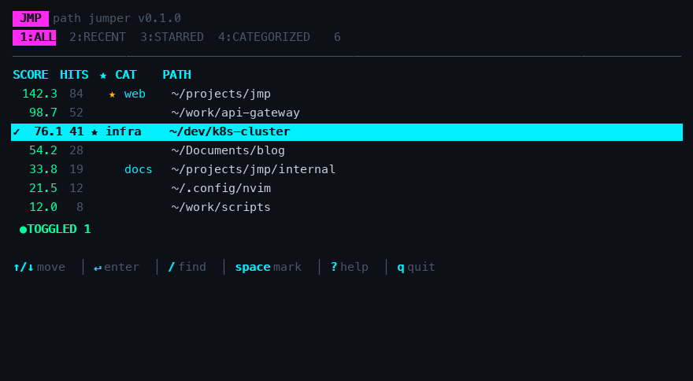

# jmp

[English](README.md) | [简体中文](README.zh-CN.md)

**jmp** 是一个智能目录跳转工具 ——
[autojump](https://github.com/wting/autojump) 的 Go 重写增强版。它会学习你
`cd` 进入过的目录，让你用几个按键就能跳回去。

排序采用 **frecency** 算法（频率 + 时效衰减），子串匹配优先于模糊匹配。
跨平台支持：macOS / Linux / WSL / Windows。

---

## 特性

- 🚀 **一键跳转** —— `j foo` 跳转到最常使用、匹配 `foo` 的目录。
- 🧠 **frecency 排序** —— 结合访问频率和 7 天半衰期的时效衰减，近期、
  高频使用的目录优先。
- 🔍 **子串 + 模糊匹配** —— 子串精确命中永远排在模糊匹配之上；多关键词
  缩小结果范围。
- 🏷️ **别名** —— `jmp alias set proj /code/project`，然后用 `j @proj` 跳转。
- 🖥️ **TUI 管理** —— 交互式界面（Bubble Tea），可搜索、星标、分类、
  编辑权重、删除记录。
- 🐚 **Shell 集成** —— 支持 bash、zsh、fish、PowerShell，带 Tab 补全和
  `back` / `fwd` / `-` 导航历史。
- 🔄 **多设备同步** —— 通过 SSH/SCP 跨设备同步数据库（pull → merge → push），
  可配置同步间隔。
- 📥 **导入** —— 从文本文件或常见历史文件导入路径。
- 🧰 **维护工具** —— `doctor`、`clean`、`stats`、JSON 输出等。

<p align="center">
  
</p>

## 快速开始

新电脑上：

```bash
# 1. 先装好 Homebrew（macOS / Linux）—— https://brew.sh
/bin/bash -c "$(curl -fsSL https://raw.githubusercontent.com/Homebrew/install/HEAD/install.sh)"

# 2. 安装 jmp
brew install biyan113/tap/jmp
# Homebrew 6.0+：若提示信任该 tap，运行 `brew trust biyan113/tap`

# 3. 在 shell 配置（~/.zshrc）里加一行，然后重启 shell
eval "$(jmp init zsh)"        # bash 同理；fish: `jmp init fish | source`
```

之后多 `cd` 几个目录积累历史，`j foo` 就能跳到最匹配的目录。
更多见下方 Shell 集成与用法章节。

## 安装

```bash
# 方式 1: Homebrew (macOS / Linux)
brew install biyan113/tap/jmp

# 方式 2: go install (需要 Go 1.21+)
go install github.com/biyan113/jmp@latest

# 方式 3: 从源码构建
make build
make install   # 安装到 /usr/local/bin/jmp

# 方式 4: 从 Releases 下载预编译二进制
# https://github.com/biyan113/jmp/releases
```

> **Homebrew 6.0+ 提示**：首次执行 `brew install biyan113/tap/jmp` 时会要求
> 信任此第三方 tap —— 按提示运行 `brew trust biyan113/tap` 即可。这是
> Homebrew 对所有第三方 tap 的标准安全检查。

需要 Go 1.21+（使用了内置的 `min`/`max`）。

## Shell 集成

将对应行加入 shell 配置文件，然后重启 shell，即可使用 `j` 命令。

```bash
# bash  (~/.bashrc)
eval "$(jmp init bash)"

# zsh   (~/.zshrc)
eval "$(jmp init zsh)"

# fish  (~/.config/fish/config.fish)
jmp init fish | source

# PowerShell  ($PROFILE)
Invoke-Expression (& jmp init powershell | Out-String)
```

集成脚本在你每次进入目录时记录一次访问（所有 shell 行为一致：按“切换目录”
计数，而不是按敲过的命令数），并在配置了同步且到期时启动一个独立的后台同步，
提示符不会等待网络。

## 使用方法

### 基本跳转

```bash
j foo          # 跳转到最匹配 "foo" 的目录
j foo bar      # 多关键词匹配（必须全部命中）
j @proj        # 通过别名跳转
j              # 打开 TUI 管理界面
j -            # 返回上一个目录
j back         # 向后跳（需要 JMP_BACK，由集成脚本设置）
j fwd          # 向前跳（需要 JMP_FWD）
j -- back      # 把 "back" 当作普通关键词查询（bash / zsh / fish）
j /etc         # 绝对路径
j ~/Documents  # 家目录相对路径
j src          # 相对子目录（数据库无匹配时）
```

**`j` 同时具备 `cd` 能力**：先查 jmp 数据库，未命中时把参数当作目录路径
`cd` 过去（支持 `~`、绝对路径、相对名）。所以 `j src` 在有记录时跳老项目，
没记录时进入当前 `src` 子目录。这样 `cd` 进入的目录也会被 shell hook 记录，
下次就能直接 `j` 到。

### 路径管理

```bash
jmp add /path/to/dir          # 记录一次访问（权重 +1），可同时给多个路径
jmp add /path/to/dir -w 10    # 把权重精确设置为 10（覆盖现有值）
jmp remove /path/to/dir       # 删除路径记录（别名: rm, del），可同时给多个路径
jmp list                      # 列出所有路径
jmp list -n 20                # 最多显示 20 条
jmp list keyword              # 按关键词过滤（-q keyword 同样可用）
jmp list --paths              # 每行只输出一个路径（适合管道）
jmp list --no-header          # 表格不带表头
```

`jmp add` 只接受现存的目录，其他路径会被拒绝并返回非零退出码。

### 别名管理

```bash
jmp alias                     # 列出所有别名
jmp alias set proj /path      # 设置别名
jmp alias remove proj         # 删除别名（别名: rm, del）
j @proj                       # 使用别名跳转
```

别名只能包含字母、数字、`.`、`_`、`-`。设置别名不会改动已有记录的权重。

### TUI 界面

```bash
jmp tui       # 打开交互式管理界面
jmp --tui     # 同上
```

按键：`↑/↓` 移动 · `enter` 跳转 · `/` 搜索 · `space` 标记 ·
`s` 星标 · `c` 分类 · `e` 编辑权重 · `+` 手动加分 · `d` 删除 · `a` 添加 ·
`1/2/3/4` 过滤（全部/最近/星标/已分类）· `i` 详情 ·
`p` 预览 · `?` 帮助 · `q` 退出。

### 数据维护

```bash
jmp stats                     # 显示数据库统计
jmp doctor                    # 检查数据库健康状态
jmp clean                     # 删除不存在的路径和失效别名
jmp clean --dry-run           # 逐条列出将删除的记录（-n）
```

**只有** `jmp clean` 会清理缺失的目录。跳转不会删除任何东西：此刻不存在的目录
（例如没挂载的移动硬盘、网络盘）只是不会被选为跳转目标，记录和权重都保留。
运行 `clean` 前请先挂载好相关卷，或先用 `--dry-run` 确认。

**安全保障。** 每次写入都是加锁的“读-改-写”，多个 shell 同时更新不会互相覆盖。
数据库每天快照一次到 `db.json.bak`；一旦 `db.json` 无法读取，jmp 会把它移到
`db.json.corrupt-<时间戳>`、恢复快照并打印警告。

### 数据导入

```bash
jmp import ~/path_history.txt   # 从文本/历史文件导入路径
fc -ln 1 | jmp import -         # 或从标准输入导入
```

只导入现存的目录，每个只计一次；数据库中已有的记录保持不变。

### 多设备同步

通过 SSH/SCP（或普通路径，例如挂载的共享目录）跨设备同步数据库。
一次同步会拉取远程副本、合并，再上传结果。

```bash
jmp sync set user@host:~/.local/share/jmp/db.json                  # 配置远程路径
jmp sync set user@host:~/.local/share/jmp/db.json --interval 600   # 带同步间隔（秒）
jmp sync                # 立即同步（pull + merge + push）
jmp sync -n -v          # 试运行：逐条列出将发生的变化，不做修改
jmp sync pull           # 仅拉取并合并
jmp sync push           # 用本地副本覆盖远程（不合并）
jmp sync status         # 查看配置、上次同步、上次尝试、上次错误
jmp sync unset          # 停止同步
jmp sync auto           # 供 shell hook 调用，立即返回
```

> 远程路径就是你希望共享副本存放的位置。远程是 macOS 时，默认数据库在
> `~/Library/Application Support/jmp/db.json`，而不是 `~/.local/share/jmp/db.json`。

**合并规则。** 权重取最大、访问次数取最大、时间取最新。删除操作
（`jmp remove`、`jmp alias remove`、在 TUI 里删除）会传播到其他设备，不会被
“复活”；如果某条记录在别处被删除之后又被访问过，则保留。两台设备上定义不同的
别名以最近设置的为准。`jmp clean` 有意只作用于本机：本机上不存在的路径在另一台
设备上可能是有效的。

**安全性。**

- 只有成功拉取并合并之后才会写远程。唯一的例外是远程文件尚不存在（首次同步）。
  其他任何拉取失败——网络、认证、远程文件损坏——都会以退出码 4 中止，远程保持不变。
- 上传是原子的：先写临时文件再重命名，其他设备不会读到写了一半的数据库。
- `scp`/`ssh` 以 `BatchMode=yes`、连接超时和总超时运行：后台同步不会弹出密码
  提示，也不会挂住。
- 失败之后，自动同步会等满一个间隔再重试；同一时间只会有一个同步在运行。

远程没有锁。如果两台设备恰好在同一瞬间同步，其中一次上传可能覆盖另一次；
但不会永久丢数据，因为合并是幂等的，缺失的改动会在产生它的那台设备下次同步时
重新上传。

> 需要对远程主机配置免密 SSH/SCP 访问（如密钥认证）。

### 配置

```bash
jmp config                                  # 查看当前配置
jmp config color <auto|always|never|ansi256|truecolor>   # 设置 TUI 颜色模式
```

### 全局选项

| 选项 | 说明 |
|------|------|
| `--db <path>` | 指定数据库文件（环境变量: `JMP_DB`） |
| `--json`      | 以 JSON 格式输出，错误也是（`{"error": ..., "code": ...}`） |
| `-v`, `--verbose` | 显示更多细节（例如逐条列出同步变化） |
| `--quiet`     | 不输出状态信息（请求的数据仍会输出） |
| `--version`   | 输出版本号（等同 `jmp version`） |

`config.json`、`sync.json` 和同步状态与数据库放在一起：默认在平台数据目录，
使用 `--db` / `JMP_DB` 时在该数据库文件旁边。

### 环境变量

| 变量 | 说明 |
|------|------|
| `JMP_DB`   | 数据库文件。shell 集成同样生效，所以 `j` 和 hook 也会使用它。 |
| `JMP_LANG` | 消息语言，`en` 或 `zh`。默认取自 `LC_ALL` / `LC_MESSAGES` / `LANG`。 |

### 退出码

| 退出码 | 含义 |
|--------|------|
| 0 | 成功 |
| 1 | 运行时错误（I/O、无效的值、路径不是目录） |
| 2 | 用法错误（未知命令或选项、参数不对） |
| 3 | 无匹配 / 记录不存在 |
| 4 | 同步无法连接或更新远程 |

错误以 `jmp: <消息>` 的形式输出到 stderr；完整的用法说明只在 `--help` 时打印。

### man 手册页

```bash
make man                 # 生成 man/jmp.1、man/jmp-sync.1 等
man ./man/jmp-sync.1
```

## 开发

```bash
make build      # 构建本地二进制
make test       # 运行测试
make lint       # 静态检查
make man        # 生成 man 手册页到 man/
make build-all  # 交叉编译所有平台到 dist/
make clean      # 清理构建产物
```

## 排序原理

每个条目的 frecency 分数为：

```
frecency = weight × 0.5 ^ (距上次访问的小时数 / 168)
```

7 天半衰期意味着一周前访问的目录价值只有现在访问的一半。当所有条目总权重
超过 9000 时，每个权重乘以 0.9（autojump 式的衰减），防止无限增长。

在 frecency 之上，`matcher.Rank` 还会叠加加成：路径末尾组件精确
匹配（×3）、前缀匹配（×1.5）、星标（×1.25）、别名匹配（×2）、
当前目录邻近（×1.2）。此刻不存在的目录不会被选为跳转目标，这样删掉或搬走的
旧路径不会压过还在的目录；它们的记录会保留到你运行 `jmp clean` 为止。
子串匹配永远排在模糊匹配之上。

## License

MIT
